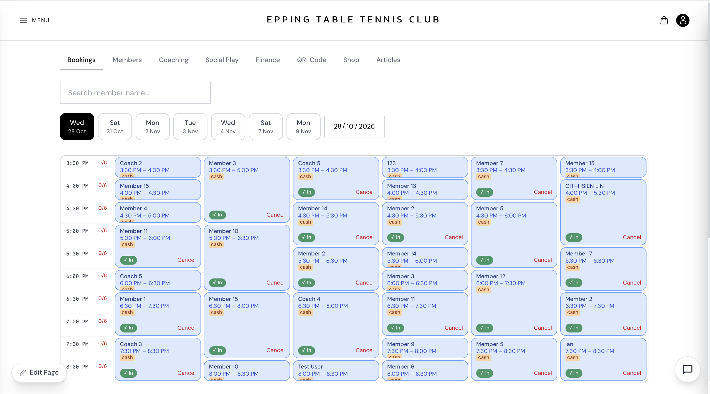
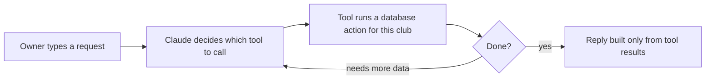

# Epping Table Tennis Club: Scheduling Platform and AI Admin Agent

An internal scheduling system I built and ran for Epping Table Tennis Club in Sydney (January to October 2026). The club owner and 5 coaches used it to plan lessons and allocate tables. The owner could also manage the schedule by typing to an AI agent in English or Chinese.

**Solo project:** I designed, built, secured and deployed all of it. The app has since been retired, so the code is here to read.



*Admin bookings view. Each column is a table, each card a lesson or booking. Member names are anonymised.*

## What it does

| Area | What the club used it for |
| --- | --- |
| **Scheduling** | Book tables and coaching lessons in 30-minute slots, including group lessons and weekly recurring lessons. |
| **No double-booking** | The database refuses a second confirmed lesson for the same coach or the same table in the same slot, even if two people click at once. |
| **Leave** | Students ask to skip a lesson and an admin approves or rejects it; pending requests expire automatically. When a coach is away, an admin can assign a cover coach or offer the students other slots. |
| **Social play** | Open sessions that members sign up for. |
| **Check-in and reminders** | QR check-in at the venue, plus a reminder email each evening for the next day's lessons. |
| **Payments** | Member balances, finance reports and a small shop, with Stripe for card payments. |
| **AI admin agent** | The owner types "move Lucy's lesson tomorrow to 7pm" and the agent does it. See below. |

## The AI admin agent

Clicking through admin screens to move or cancel lessons was slow, so I added a Claude agent that can do every admin action from a chat box.



- **48 tools** cover the same actions as the admin dashboard: members, lessons, bookings, leave requests, social play, announcements and reports. Every tool is limited to this club's data.
- **No made-up answers.** The agent must call a tool before answering, every name and date must come from a tool result, and it runs at temperature 0.
- **Errors are passed through word for word.** If a tool says a table is already taken, the owner sees that exact message, not a vague "something went wrong".
- **Stays on topic.** Anything unrelated to running the club gets "I can only help with club management tasks."
- **Admin only.** The endpoint is behind login plus an admin check, and each request is capped at 10 tool rounds so it can't loop forever.

The code is in [`server/src/routes/ai.js`](server/src/routes/ai.js).

## Security work

I reviewed the API for security problems and fixed:

- **Member data leak:** any logged-in member could look up other members' email and phone numbers. Now only admins and the member themselves can.
- **Path traversal:** a crafted product-image filename could read files outside the uploads folder.
- **Cross-club payments:** Stripe capture and void now check that the payment belongs to this club.
- **Abuse limits:** rate limits on sign-up and password reset plus a general API limit; passwords need 8+ characters.
- **Hardening:** security headers (`helmet`), a strict CORS list, no raw database errors sent to the browser, and the server refuses to start in production without its secrets.

## Tech stack

| Layer | Tools |
| --- | --- |
| Frontend | React 18, Vite, Tailwind CSS (installable as a PWA) |
| Backend | Node.js, Express, `node-cron` for scheduled jobs |
| Database | PostgreSQL |
| AI | Claude API (Anthropic SDK) with tool calling |
| Services | Stripe (payments), Resend (email), Google sign-in |
| Hosting | API on AWS EC2 with pm2; frontend on Cloudflare |
| CI | GitHub Actions: builds the frontend and checks the server on every push |

## Project structure

```
src/                 React frontend
  pages/             one file per page (bookings, coaching, admin dashboard...)
  api/api.js         every call the frontend makes to the API
server/
  src/routes/        Express routes, one file per area (bookings, coaching, ai...)
  src/middleware/    login checks, rate limits, club lookup
  src/jobs/          scheduled jobs: leave-request expiry, reminder emails
  src/db/            base schema and the migrations added over time
  scripts/           one-off database scripts (data cleanup, usage stats)
docs/                deployment notes and screenshots
```

## Running it

This was a production app for one club, so there is no one-command demo. The database schema grew through incremental migrations in `server/src/db/`, and the app expects a club row to exist. To explore the code locally:

```bash
npm install && npm run dev                  # frontend on http://localhost:5173
cd server && npm install && npm run dev     # API on http://localhost:8000
```

Copy `.env.example` and `server/.env.example` to `.env` first. [`docs/deployment.md`](docs/deployment.md) has the production setup.
